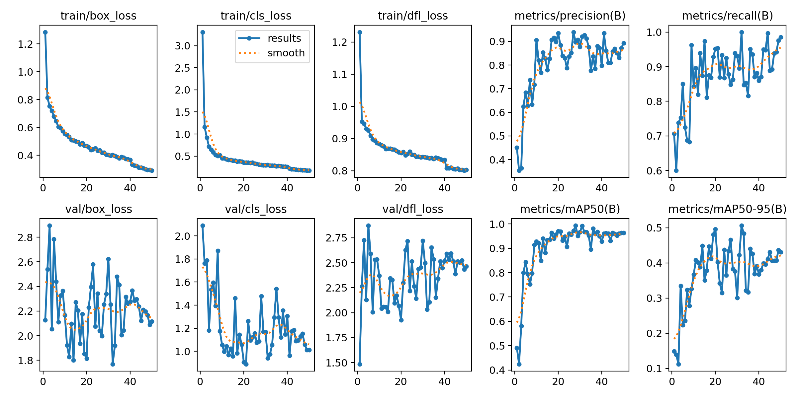

# Drone-Based Municipal Infrastructure Inspection

A DJI Tello drone streams video to a laptop, where a YOLOv8n model classifies **streetlights and traffic lights as working or faulty**. A Streamlit dashboard shows the detections and compares them with ground-truth fault states from an Arduino-driven miniature city.

Final-year engineering project, BEngTech Electronic and Computer Engineering, Durban University of Technology (2026).

## How it works

1. **Ground truth:** an Arduino Mega (`LED_CONTROL.ino`) drives the miniature city's traffic lights and streetlights, alternating between a working phase and a faulty phase (flickering red light, stuck-dim LEDs, dimmed streetlights) and logging the state.
2. **Capture:** the drone is flown over the model (`FLYING_DRONE.py`) and its video is streamed to the laptop.
3. **Detection:** YOLOv8n classifies four classes: `traffic_light-working`, `traffic_light-faulty`, `streetlight-working`, `streetlight-faulty`.
4. **Dashboard:** a Streamlit app displays detections and compares them with the Arduino log.

## Results

Final model (Model C) evaluated on four recordings not used for training:
431 images containing 1,724 labelled objects, at a confidence threshold of 0.7.

| Metric | Result | Target |
|---|---|---|
| mAP@0.5 | 0.876 | ≥ 0.85 |
| Mean F1-score (4 classes) | 0.86 | ≥ 0.80 |
| Mean precision / mean recall | 0.91 / 0.83 | n/a |
| Objects correctly classified | 1,425 of 1,724 (82.7%) | n/a |
| Live latency, frame received to result saved | 255 ms mean, 428 ms max | ≤ 500 ms |

### Per-class results (confidence 0.7)

| Class | Precision | Recall | F1 |
|---|---|---|---|
| Traffic light, working | 0.85 | 0.79 | 0.82 |
| Traffic light, faulty | 0.94 | 0.83 | 0.88 |
| Streetlight, working | 0.94 | 0.72 | 0.82 |
| Streetlight, faulty | 0.90 | 0.96 | 0.93 |

### Notes

- No faulty light was classified as working. Errors were missed objects or
  false fault reports.
- The weakest class was working streetlights, which were sometimes missed or
  classified as faulty, mainly in low-light footage.
- Model inference took 11.8 ms on a Tesla T4 GPU at 640 px. On the laptop CPU
  it took about 145-185 ms per image at 960 px. The live system figure above
  is the one that applies in practice.
- Results come from one miniature-city test environment. See the final report
  for full methodology and limitations.

## Limitations

- Small custom dataset recorded in one indoor miniature environment, so results may not transfer to real streets.
- Traffic lights were harder to classify than streetlights.
- The drone is flown manually, with no autonomous navigation.
- Speed was measured on a GPU. Laptop timings will differ.

## Tech

Python · YOLOv8 (Ultralytics) · Streamlit · Arduino · DJI Tello · Google Colab

## Files

| File | Purpose |
|---|---|
| `FLYING_DRONE.py` | Drone control and video capture |
| `LED_CONTROL.ino` | Arduino sketch for the fault-simulation rig |
| `results.png` | Training curves |
